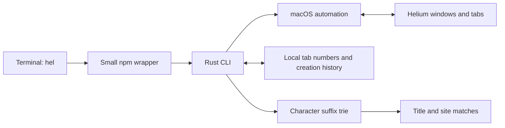

# helium-cli

A small Rust CLI for opening, finding, and switching Helium tabs from your terminal on macOS.

Built for the moment when you are too lazy to Alt-Tab to search something up, but still want the results in your browser. Helium stays lightweight: `hel` runs a short automation request and exits. There is no background service, extension, or remote debugging port.

## Install

Requires macOS, [Helium](https://helium.computer/) in `/Applications/Helium.app`, Node.js 18 or newer with npm, and [Rust](https://rustup.rs/) 1.89 or newer with Cargo. Rust compiles the CLI during installation; npm supplies the command wrapper.

From GitHub:

```sh
npm install --global git+https://github.com/ericx057/helium-cli.git
hel --help
```

If npm's global directory requires administrator access, install with `npm install --global --prefix "$HOME/.local" git+https://github.com/ericx057/helium-cli.git` and ensure `~/.local/bin` is on your `PATH`. Use the same prefix when uninstalling.

Or from a checkout:

```sh
git clone https://github.com/ericx057/helium-cli.git
cd helium-cli
npm install --global .
hel --help
```

For a Rust-only installation, run `cargo install --path . --locked` from the checkout. Ensure `~/.cargo/bin` is on your `PATH`.

On first use, macOS may ask whether your terminal can control Helium. Allow it. If permission was previously denied, enable your terminal's Helium entry under **System Settings → Privacy & Security → Automation**.

## Commands

| Command | Behavior |
| --- | --- |
| `hel "search text"` | Open a new Helium tab with DuckDuckGo search results. |
| `hel new` | Open a new tab with a blank address field. |
| `hel close` | Close the most recent still-open tab created by `hel`. |
| `hel open` | Open a new Helium window using your existing profile. |
| `hel quit` | Close the most recent still-open window created by `hel open`. |
| `hel list` | List open tabs across Helium windows with their numbers. |
| `hel tab 3` | Focus tab 3 and bring its window forward. |
| `hel tab "title"` | Find titles containing the text; focus a unique match, otherwise list matches. |
| `hel search "youtube"` | List tabs whose hostname contains `youtube`. |
| `hel tab "youtube" "rust"` | List tabs matching both the site and title, in that order. |
| `hel --help` | Show usage. |

Examples:

```sh
hel "how to borrow a string in Rust"
hel search "youtube"
hel tab "youtube" "tutorial"
hel tab 3
```

Searches ignore letter case. Title search matches any part of the title, including Unicode text. Site search uses the URL hostname, so `youtube` matches `youtube.com` and `music.youtube.com`, but does not match a different site's path or query. Empty queries are rejected; a missing site or title match reports `No match`.

Tab numbers stay consistent when you focus another window. Opening or closing tabs can change numbering; run `hel list` again after those changes. Use the numbers printed by `hel list` or either search command. `close` and `quit` operate on `hel`'s saved creation history and skip entries you have already closed manually. Restarting Helium resets that history. A window is the “instance” managed by `open` and `quit`; Helium continues to manage its own browser processes.

## Design



Each title is indexed from every character using a suffix trie, storing up to eight characters per starting position. A title query walks one branch, then checks the full query against candidate titles. This bounds index construction to linear space and a fixed number of tree insertions per title character, including for long titles. Many titles sharing the same first eight query characters require more candidate checks. The index is built only when a title search needs it, using live tabs on each invocation, so changed titles and closed tabs do not leave stale results. Site matching checks hostnames separately without building the title tree; combined search intersects the results.

Automation addresses tabs and windows by their browser IDs. Saved state contains those IDs and local numbering/history, rather than a copy of your browsing titles or URLs. Closing a tracked window also closes its tabs, including any you added manually after `hel open`.

## Development

```sh
cargo test --locked
cargo clippy --all-targets -- -D warnings
npm test
```

After `cargo build --release --locked`, run `npm run smoke` for a live browser check. It opens a temporary window, tests the commands, and closes that window while checking that your original tabs remain open.

The Rust tests cover command parsing, indexing, state, and automation data handling. Node tests cover installer and wrapper behavior without opening or closing browser tabs.

## Delete

From the checkout:

```sh
npm run delete
```

Or from any directory:

```sh
npm uninstall --global @ericx057/helium-cli
```

For an installation under `~/.local`, use `npm uninstall --global --prefix "$HOME/.local" @ericx057/helium-cli`, or run the delete script with `npm_config_prefix="$HOME/.local" npm run delete`.

These remove the npm-installed command. For a Rust-only install, use `cargo uninstall hel`. Removing the CLI does not uninstall Helium or close its tabs. To also clear saved tab numbers and creation history, remove `~/.local/state/hel` (or `$XDG_STATE_HOME/hel` if you set `XDG_STATE_HOME`).

## License

[MIT](LICENSE).
